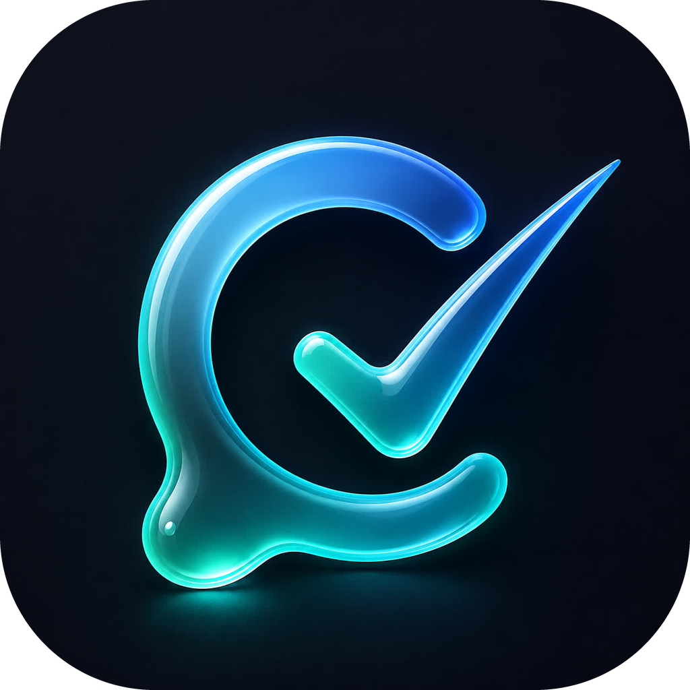

<div align="center">



# FreeLog

**Track time. Own your work. Impress your clients.**

*An offline-first desktop app for freelancers: automatic time tracking, tasks & projects, a calendar with reminders, and professional client reports.*

    

[فارسی](README.fa.md) · [Quick start](#-quick-start) · [Features](#-feature-tour) · [Status](#-honest-status) · [Support](#-support-freelog)

</div>

---

## Why FreeLog?

Freelancers lose money in three places: **time nobody wrote down**, **work that quietly slips**, and **clients who feel in the dark**. FreeLog attacks all three from one app that never sends your data anywhere.

* It **measures** what you really did, hour by hour — then asks you only about the part nobody has accounted for.
* It **catches what slips** — overdue, postponed and missed items are ranked and fitted into a realistic recovery plan.
* It **writes your client reports** — weekly, milestone, invoice — with US dates, your client's time zone, charts and a PDF, and shows the client *only* what you allow.

Persian (Jalali, RTL) and English (Gregorian, LTR) are both first-class.

---

## ✨ Feature tour

### ⏱ Know where the hours went
| | |
|---|---|
| **Timers & Pomodoro** | One-click timers, a water-sphere Pomodoro orb, quick start from anywhere. |
| **Automatic tracking** | Follows the active window; an engagement model tells *active* from *passive* (calls, slides, reading) from *idle*; a frozen screen or a mouse jiggler is detected from a 32×18 thumbnail every 30 s. |
| **Hourly ledger** | Exact active / passive / idle seconds per clock hour and per app. Laptop sleep and screen lock add nothing. Overlapping entries are never double-counted. |
| **Hour-by-hour prompt** | After each finished hour it asks about the *unlogged* part only, pre-filled with measured minutes and apps, and drops your answer into the real free slot. A 24-hour strip on *Today* shows measured vs logged work; click a dotted hour to answer it. |
| **Screenshots** | Hourly, zipped, private. Each one records **what was open**: the active File Explorer folder (even the active tab), the browser tab, the editor file. Interval, ±jitter, working hours and days off are yours to set; they never appear in client output. |

### ✅ Tasks that actually get done
* **Lists (Google-Tasks style, but more):** tick to complete, drag between lists or to reorder, star, sub-tasks, sort by due date, clear completed, **paste a whole Markdown check list** (`- [ ] task #tag @project 45m d:2026-05-03`, indent = sub-task, `[x]` = done) and optional **two-way Google Tasks sync**.
* **Quick-access bubble:** a draggable floating orb with a panel for tasks, time logs, timers and a **check-list mode** — tick items or add several at once (`milk; bread; call`) without opening the app. Global shortcut **Ctrl+Shift+Space**.
* **Project breakdown:** turn one outline into **phases → tasks → sub-tasks** (templates for a book, a digital product, a course), split a big task into sub-tasks with a shared estimate, or split a project in two.
* **Quick project:** create a project from inside *Add task* with one field and Enter.
* Kanban board, Eisenhower matrix, planner, habits, routines (hourly → monthly check boxes), goals, sprints with burndown and forecast.

### 🧭 Catch-up: stop the slipping
Overdue tasks, missed planned blocks, tasks you pushed more than once and missed routine check boxes are **scored** (priority, importance, lateness, how many times postponed, effort) and given one of five actions — **do now, today, schedule, split, drop**. FreeLog fits them into your next working days **within your real daily capacity**, applies the plan in one click, counts every postponement honestly and warns you on the third push. A morning briefing tells you what to do first.

### 🧑‍💼 Client reporting
* **Reports:** daily digest, weekly, milestone, invoice-ready, snapshot — HTML, **PDF (A4, page numbers)**, Markdown, JSON.
* **Charts:** burn-up/burn-down, velocity, cumulative flow, Gantt, donut, activity heatmap, billable trend, period comparison (SVG + PNG, print-friendly).
* **US-ready:** `Mar 14, 2026`, `$1,234.50`, Sunday-first weeks, US federal holidays (with observed dates), each client's own time zone, Net-N terms, tax %, billing increments (6 / 15 / 30 min, rounded up).
* **Privacy gate:** only billable work or work you flag is ever shown; internal notes and anything tagged `internal` never leave. You write the client-facing note separately.
* **Smart digest:** a short executive summary written from your numbers (optional local LLM via Ollama); you edit and approve it — **nothing is sent without approval**.
* **Health you can explain:** weighted progress, RAG status *with reasons*, blocker aging, stale tasks, scope-creep vs a frozen baseline, 75/90/100 % budget alerts, retainer tracking, velocity forecast, deadlines on holidays.
* **Relationship tools (service layer):** client health score (0–100), silence alert, promise tracker, onboarding checklist, meeting log, risk register, deliverable approvals, public change log, upsell hint.

### 🗓 Calendar & reminders *(engine complete — new UI in progress, see Status)*
Recurring events (daily / weekly / monthly, skip or move one occurrence), **reminders that say the DAY a day before and the HOUR two hours before**, safe join links (http/https only), optional **auto-open at start**, natural quick-add (`Call with Acme next Tue 3pm 1h https://… remind 1d,2h`), and exact **00:00–24:00 day analysis** per project (gaps, focus blocks, plan vs reality).

### 🎨 Made to be looked at
Liquid-glass UI with live theme switching, 64 vector icons, drag-able droplets, squishy switches, and a logo that shows up in the title bar, taskbar, tray and desktop shortcuts. RTL ↔ LTR, Jalali ↔ Gregorian, Persian ↔ Latin digits.

### 🔒 Your data, your machine
SQLite (WAL) on disk, **no account, no cloud, no telemetry**. Daily automatic backups; exact export/restore (`.wtpack`: SHA-256 manifest, optional AES-256, atomic restore with a safety copy).

---

## 🚀 Quick start

```bash
git clone <your-repo-url> freelog && cd freelog
python -m venv .venv && . .venv/bin/activate        # Windows: .venv\Scripts\activate
pip install -r requirements.txt
python -m worktracker.main                          # or double-click FreeLog.pyw / run.bat on Windows
```
Python 3.10+. First start creates the **Desktop and Start-menu shortcuts with the FreeLog icon** (turn off in Settings → `create_shortcuts`). Troubleshooting: `python -m worktracker.tools.doctor`.

Optional extras: `weasyprint` (best PDF), `google-api-python-client` + `google-auth-oauthlib` (Google sync), `tzdata` (Windows time zones).

**Linux note:** active-window and idle detection use `xdotool` / `xprintidle`; Wayland may limit them.

### Quick-capture grammar
`Write proposal #docs @Acme 45m` · `09:30-10:00 standup` · `Call with Acme next Tue 3pm 1h https://meet… remind 1d,2h` · `Weekly webinar every Wed 18:00 https://zoom…`

## 🗂 Project map
```
worktracker/
  core/       models, SQLite database + migrations (v1→v8), Persian/Jalali time, CRM store
  services/   rules & algorithms (no Qt): ledger, catchup, lists, project_split, project_health, client_ops,
              calendar_events, calendar_ops, day_analysis, checkin, context, screenshots, backup_pack …
  reports/    builders · charts · render (Jinja2) · pdf (WeasyPrint / ReportLab) · service · US locale
  integrations/ Google Tasks / Calendar, webhooks, local API
  ui/         PyQt5: glass widgets, pages, dialogs, floating bubble, runtime timers
  tests/      420+ tests (logic) + UI tests on a Qt stand-in
assets/       logo, icons (png / ico / icns), fonts
```

## ✅ Honest status
| Area | State |
|---|---|
| Time tracking, ledger, prompts, screenshots + context, lists, catch-up, project breakdown, backups, client-report engine (HTML/PDF/MD/JSON), health & client services | **Implemented and unit-tested** |
| UI code | Run against a **Qt stand-in in CI-style tests**; written for real PyQt5 but **not visually verified here** — please report any layout glitch with a screenshot |
| Google Tasks sync | Tested against a faithful in-memory fake of the API, **not the live service** |
| Hourly forced check-in (last hour + next-hour plan) | Service **done and tested**; popup UI **in progress** |
| Calendar redesign (day / 3-day / week / month grid, drag & resize, reminder pop-ups with countdown & join button) | Engine **done and tested**; UI **in progress** |
| E-mail sending, local client portal, scheduler, client-management screens for promises / health | **Planned** (service layer exists) |

## ❤️ Support FreeLog
FreeLog is built in the open by one person. If it saves you time or wins you a client:
* ⭐ **Star the repository** — it is the cheapest way to help and it genuinely matters.
* 📣 **Tell another freelancer** — a post, a message, a mention.
* 🐞 **Report bugs and glitches** (a screenshot is gold) and **suggest features**.
* 🌍 **Contribute a translation** or a theme.
* ☕ **Sponsor the work** — add your sponsor/donation link here: `<!-- your link -->`.

Use it, enjoy it, and make it yours.

## 👤 Author
**Amirhossein Barzegar (امیرحسین برزگر)** — creator & maintainer · **barzanics**

## 📄 License
MIT © 2026 Amirhossein Barzegar (barzanics). See [LICENSE](LICENSE).
